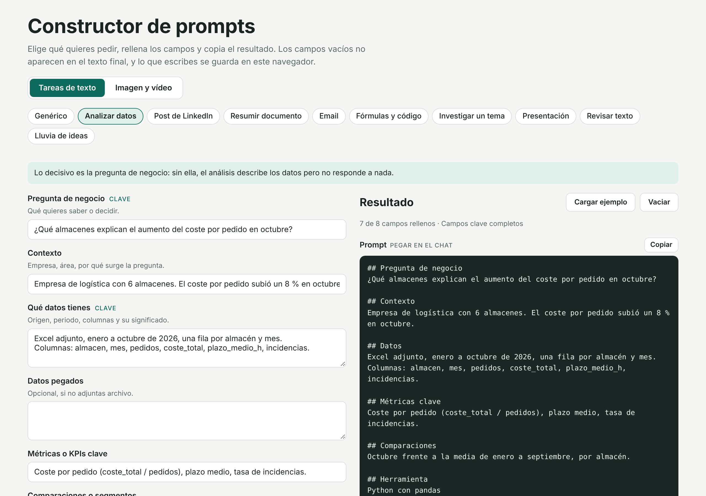
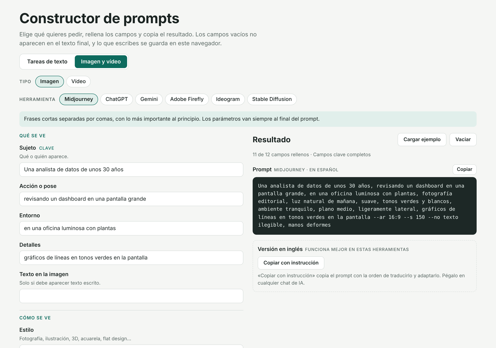

# Constructor de prompts

Formulario web para escribir prompts completos sin tener que recordar qué información necesita cada tipo de petición.

**[Abrir la herramienta](https://paoalbandata.github.io/Constructor-prompts/)**

## Para qué sirve

Muchas respuestas flojas de un asistente de IA vienen de peticiones incompletas: falta el objetivo, el formato esperado o el contexto. El formulario pide esa información según lo que quieras hacer y la ordena en un prompt listo para pegar en Claude, ChatGPT, Gemini o la herramienta que uses.

Tiene dos modos.

**Tareas de texto.** Cada tarea tiene sus propios campos y termina con una instrucción de buenas prácticas para ese caso:

| Tarea | Lo que pide además de lo básico |
|---|---|
| Genérico | Contexto, tarea, objetivo, material, restricciones, formato |
| Analizar datos | Pregunta de negocio, estructura de los datos, métricas, comparaciones |
| Post de LinkedIn | Idea principal, experiencia propia, público, llamada a la acción |
| Resumir documento | Destinatario, uso del resumen, qué priorizar y qué ignorar |
| Email | Relación con el destinatario, objetivo, puntos que debe incluir |
| Fórmulas y código | Lenguaje, estructura de tablas, resultado esperado, error actual |
| Investigar un tema | Ámbito, periodo, profundidad, fuentes preferidas |
| Presentación | Público, mensaje clave, número de diapositivas, datos |
| Revisar texto | Qué mejorar y qué no tocar |
| Lluvia de ideas | Restricciones, ideas ya descartadas, criterio de priorización |

**Imagen y vídeo.** Los campos son comunes (sujeto, acción, entorno, estilo, luz, encuadre…) y el resultado se adapta a cada herramienta:

- **Midjourney:** descriptores separados por comas y parámetros al final (`--ar`, `--s`, `--style raw`, `--no`).
- **ChatGPT, Gemini, Adobe Firefly, Ideogram:** frases completas; el texto que debe aparecer en la imagen va entre comillas.
- **Stable Diffusion y Kling:** lo que hay que evitar sale en un bloque aparte para el campo de prompt negativo.
- **Runway:** si partes de una imagen, el prompt describe solo el movimiento y no incluye instrucciones negativas.
- **Google Veo y Sora:** campos de sonido ambiente y diálogo.

Cuando un ajuste se elige en la interfaz de la herramienta (proporción, duración), aparece como recordatorio en lugar de mezclarse con el prompt.

### Versión en inglés

Varias de estas herramientas responden mejor en inglés. El botón «Copiar con instrucción» copia el prompt junto con la orden de traducirlo y adaptarlo a la herramienta elegida, para pegarlo en cualquier chat de IA.

Si la página se abre como artifact dentro de Claude, aparece además «Traducir y adaptar con Claude», que hace la traducción en la propia página con la cuenta de Claude de quien la usa. Fuera de Claude ese botón no se muestra.

## Cómo usarlo

1. Elige el modo y la tarea o la herramienta.
2. Rellena los campos. Los marcados como «clave» son los que más influyen en el resultado; el texto gris de cada campo es un ejemplo.
3. Copia el resultado y pégalo donde vayas a usarlo.

«Cargar ejemplo» rellena un caso completo para ver cómo queda.

## Detalles técnicos

- Un único archivo `index.html` con HTML, CSS y JavaScript sin dependencias ni proceso de build. Las fuentes (Bricolage Grotesque e IBM Plex, licencia OFL) están alojadas en el propio repositorio, así que la página no hace peticiones a Google Fonts.
- Lo que escribes se guarda en el `localStorage` de tu navegador y no se envía a ningún servidor.
- La versión publicada usa el banner de cookies compartido del portfolio: Google Analytics solo mide visitas si la persona lo acepta.
- Tema claro y oscuro según la configuración del sistema, y diseño adaptado a móvil.
- Publicado con GitHub Pages desde la rama `main`.

Para probarlo en local basta con abrir `index.html` en el navegador.

## Limitaciones

- El formulario ordena lo que escribes; no comprueba si el contenido es bueno.
- Los parámetros y la sintaxis de las herramientas de imagen y vídeo cambian con frecuencia. Las indicaciones se revisaron en noviembre de 2026.

## Licencia

[MIT](LICENSE)
